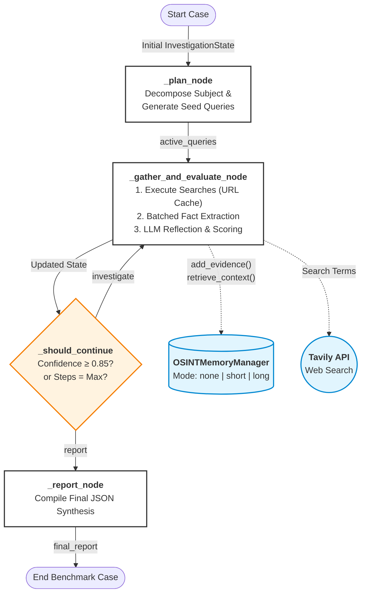

# Agentic Harness for OSINT

An autonomous Open Source Intelligence (OSINT) investigation agent built with LangGraph. This system autonomously investigates subjects (companies, individuals, or factual claims), gathers external documents, evaluates source reliability, resolves conflicting information, and produces a structured findings report trusted by human analysts.

---

## Key Features

* **Autonomous Reasoning Loop:** Uses a LangGraph state machine to plan queries, gather evidence, evaluate reliability, and reflect on findings before reaching a stable conclusion.
* **Memory Ablation Testing:** Configurable memory modes (`none`, `short`, `long`) to evaluate how context retention and vector retrieval impact accuracy, token efficiency, and memory interference.
* **Telemetry & Benchmarking:** Built-in evaluation harness that tracks step-level rewards, convergence steps, verdict changes, execution latency, and token cost per investigation.
* **Multi-Source Tooling:** Integrates Tavily and web scraping with automated formatting and Markdown stripping for robust tool execution.
* **Provider Agnostic:** Out-of-the-box support for free and local LLMs including Google Gemini, Groq, and Ollama via LangChain.

---

## Repository Structure

```text
osint_harness/
├── benchmark_results/     # Generated benchmark CSV logs and ablation reports on benchmark cases
├── config.py              # LLM setup, API keys, and Domain Reliability tiers
├── schemas.py             # Pydantic models for structured evidence and final reports
├── memory.py              # Short-term and Long-term memory manager with ablation
├── tools.py               # External search (ddgs) and document scraping tools
├── agent.py               # LangGraph state machine and core evaluation logic
├── metrics.py             # Reward, convergence, and efficiency formula calculations
├── benchmark_runner.py    # Multi-case evaluation suite and CSV exporter
├── requirements.txt       # Project dependencies
└── README.md              # Project documentation
```

---

## Installation

1. **Create and activate a clean Conda environment:**
   ```bash
   conda create -n osint_harness python=3.11 -y
   conda activate osint_harness
   ```

2. **Install core agent dependencies:**
   ```bash
   pip install langgraph langchain-core langchain-openai langchain-google-genai langchain-groq langchain-ollama pydantic python-dotenv
   ```

3. **Install scraping and benchmarking packages:**
   ```bash
   pip install tavily-python requests beautifulsoup4 pandas numpy
   ```

---

## Configuration

Create a `.env` file in the root directory to store model configurations and API credentials:

```env
# Provider selection: "openai", "gemini", "groq", or "ollama"
LLM_PROVIDER="groq"
LLM_MODEL="openai/gpt-oss-20b"

# API Keys
GEMINI_API_KEY="your-gemini-api-key"
GROQ_API_KEY="your-groq-api-key"
TAVILY_API_KEY="your-tavily-api-key"

# Optional: LangSmith Telemetry
LANGCHAIN_TRACING_V2="false"
LANGCHAIN_API_KEY="your-langsmith-key"
LANGCHAIN_PROJECT="OSINT-Agent-Harness"
```

---

## Usage & Benchmarking

Run the complete evaluation suite across all memory configurations (`none`, `short`, `long`):

```bash
python benchmark_runner.py
```

This runs the investigation against predefined benchmark subjects and claims, logging:
* Execution steps and latency per node
* Step-level reward progression
* Convergence speed and verdict stability
* Results exported automatically to `osint_benchmark_metrics.csv`

---

## Architecture


The following diagram illustrates the cyclic LangGraph state machine, highlighting the interaction between the core operational nodes, the external memory manager, and the conditional routing logic. 


